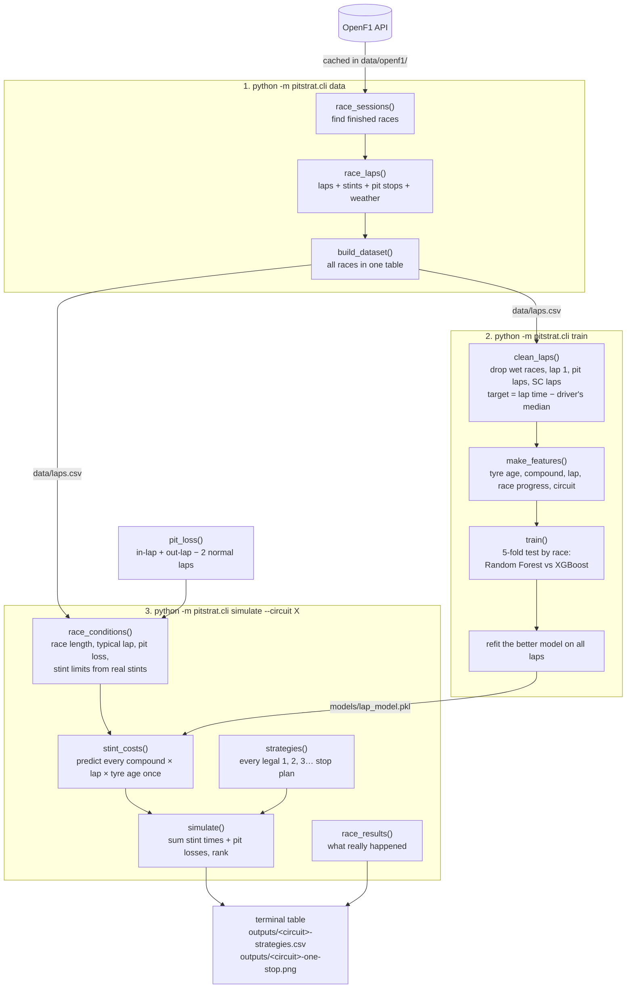

# How it works

The project runs in three commands. Each one saves a file that the next one reads.



## The idea in four lines

1. The model never predicts a full lap time. It predicts how much slower or faster a lap is than that driver's typical lap in the race, called the **lap delta**. That removes car and driver speed, so only tyre wear, fuel burn and circuit remain.
2. A simulated lap = the circuit's typical lap + the predicted delta.
3. A strategy's race time = the sum of its laps + one pit loss per stop.
4. The fastest total wins.

## Where to start reading

The code is about 700 lines. Read it in this order; each step uses only things from the steps before it.

| # | File | Read | What you learn |
|---|---|---|---|
| 1 | [`pitstrat/config.py`](../pitstrat/config.py) | the whole file (39 lines) | Every setting: seasons, file paths, the 7% outlier rule, stint limits. |
| 2 | [`pitstrat/cli.py`](../pitstrat/cli.py) | `main()` then `run_data`, `run_train`, `run_simulate` | The three commands and the order everything is called in. This is the table of contents. |
| 3 | [`pitstrat/data.py`](../pitstrat/data.py) | `fetch` → `fetch_cached` → `race_sessions` → `race_laps` → `build_dataset` | How raw OpenF1 data becomes one row per lap. `race_laps` is the densest function in the project: it joins five feeds. |
| 4 | [`pitstrat/data.py`](../pitstrat/data.py) | `clean_laps` | Which laps are thrown away and how the target, `LapDelta`, is made. The most important function for understanding the model. |
| 5 | [`pitstrat/features.py`](../pitstrat/features.py) | `make_features` (21 lines) | The exact inputs the model sees. |
| 6 | [`pitstrat/train.py`](../pitstrat/train.py) | `candidate_models` → `race_folds` → `train` | How the two models are compared fairly and why the split is by race. |
| 7 | [`pitstrat/pit_loss.py`](../pitstrat/pit_loss.py) | `stop_losses` → `pit_loss` | How the cost of a pit stop is measured from real stops. |
| 8 | [`pitstrat/simulate.py`](../pitstrat/simulate.py) | `Race` → `stint_limits` → `race_conditions` → `strategies` → `stint_costs` → `simulate` | The strategy search. Read `strategies` before `stint_costs`; it's easier. |
| 9 | [`pitstrat/data.py`](../pitstrat/data.py) | `strategies_used` → `race_results` | The real-race table printed under the prediction. |
| 10 | [`pitstrat/plot.py`](../pitstrat/plot.py) | `plot_one_stop` | The chart. Only matplotlib styling; skip it if you like. |
| 11 | [`tests/test_pitstrat.py`](../tests/test_pitstrat.py) | every test | Small, hand-checkable examples of each step. `test_simulate_ranks_strategies_by_total_time` adds up one strategy by hand. |

### Tips

- **Follow one command end to end.** Put a breakpoint in `run_simulate` in PyCharm, run `simulate --circuit Monza` in the debugger, and step into each call.
- **Look at the data between steps.** In a Python console:

  ```python
  from pitstrat.data import load_dataset, clean_laps
  raw = load_dataset()
  clean = clean_laps(raw)
  clean[clean.Circuit == "Monza"].head(20)
  ```

- **`stint_costs` is a speed trick.** Instead of predicting every lap of 14,000 strategies, it predicts each (compound, lap, tyre age) combination once and adds them up. `costs["SOFT"][10, 15]` is the predicted time of a 15-lap soft stint starting on lap 10.
- **`strategies` encodes the rules.** It allows only strategies with at least two different compounds and stints between `MIN_STINT` and each compound's limit at that circuit. `stint_limits` sets those limits from the stints teams really ran there.
